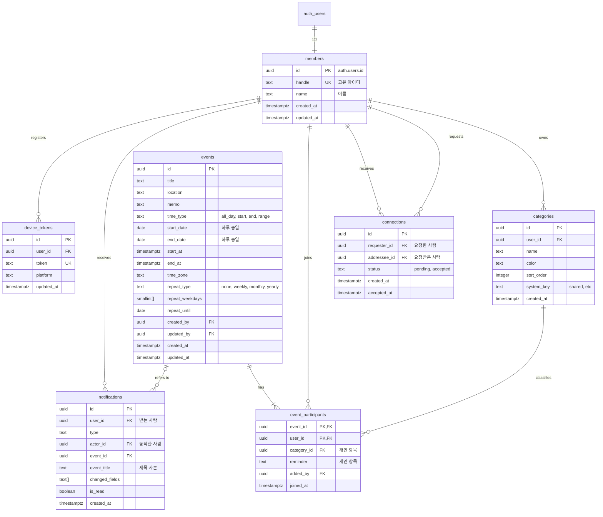

# 심이베 캘린더 ERD 및 테이블 정의서 (v1.0)

| 항목 | 내용 |
|---|---|
| 대상 버전 | 1.0 (안드로이드) |
| 데이터베이스 | Supabase (PostgreSQL) |
| 참고 문서 | `docs/02-requirements/요구사항정의서.md`, `docs/03-design/화면설계서.md` |

## 1. 설계 원칙

| 항목 | 원칙 |
|---|---|
| 계정 | 이메일과 비밀번호는 Supabase Auth의 `auth.users`가 관리한다. 비밀번호는 bcrypt 해시로만 저장되어 관리자도 원래 값을 볼 수 없다. 앱 테이블(`members`)에는 이메일과 비밀번호를 저장하지 않는다 (NFR-005, NFR-007) |
| 기본 키 | 모든 테이블은 `uuid` 기본 키를 쓴다. 값은 `gen_random_uuid()`로 만든다 |
| 시간 | 시각은 `timestamptz`(UTC)로 저장하고 기기 시간대로 표시한다. 하루 종일 일정은 `date`로 저장한다 (NFR-008) |
| 공통 항목과 개인 항목 | 일정의 공통 항목(제목, 시간, 장소, 메모, 반복)은 `events`에, 사람마다 다른 항목(분류, 미리 알림)은 `event_participants`에 둔다 (REQ-EVENT-006) |
| 반복 | 반복 규칙만 저장하고 날짜는 앱에서 계산해 펼친다. 수정과 빼기는 반복 전체에 적용된다 (REQ-REPEAT-004) |
| 미리 알림 | 서버에 예약하지 않는다. 앱이 휴대폰 안에 알림을 예약하고, 일정이 바뀌면 다시 예약한다 |
| 권한 | 모든 테이블에 RLS(행 단위 보안)를 켠다. 여러 테이블을 함께 바꾸거나 권한 확인이 복잡한 동작은 서버 함수(RPC)로만 한다 (NFR-006) |
| 삭제 | 회원 탈퇴는 연관 데이터를 함께 지운다(`ON DELETE CASCADE`). 일정은 마지막 참여자가 빠질 때 서버가 지운다 (REQ-EVENT-008) |

## 2. ERD

| 관계 | 설명 |
|---|---|
| 계정 1 : 회원 1 | 가입하면 `auth.users`에 계정이 생기고, 서버가 같은 `id`로 `members`를 만든다 |
| 사용자 N : 일정 N | `event_participants`가 사용자와 일정을 잇는다. 이 행 하나가 "이 일정이 내 달력에 있다"는 뜻이다 |
| 사용자 1 : 분류 N | 분류는 사람마다 따로 있다. 참여자 행은 그 사람의 분류 하나를 가리킨다 |
| 사용자 N : 사용자 N | `connections`의 한 행이 두 사람 사이의 요청 또는 연결 하나를 나타낸다. 방향과 관계없이 두 사람 사이에는 한 행만 있다 |

## 3. 테이블 정의

표기: **PK** 기본 키, **FK** 외래 키, **UK** 중복 불가, **NN** 필수(NOT NULL)

### 3.1 members (회원)

사용자의 공개 정보. 다른 사람에게는 고유 아이디와 이름만 보인다.

| 컬럼 | 자료형 | 제약 | 기본값 | 설명 |
|---|---|---|---|---|
| id | uuid | PK, FK → `auth.users.id` ON DELETE CASCADE | | 계정 아이디 |
| handle | text | UK, NN, 규칙 검사 | | 고유 아이디. 영문 소문자와 숫자 8~20자, 영문과 숫자를 모두 포함. 소문자로 저장한다. 변경 불가 (REQ-AUTH-003, 004) |
| name | text | NN, 1~20자 | | 이름. 중복 허용 (REQ-AUTH-008) |
| created_at | timestamptz | NN | `now()` | 가입 시각 |
| updated_at | timestamptz | NN | `now()` | 수정 시각 |

- `handle` 규칙: `handle ~ '^(?=.*[a-z])(?=.*[0-9])[a-z0-9]{8,20}$'`
- `handle`을 바꾸려는 수정은 트리거가 막는다.

### 3.2 connections (연결)

연결 요청과 연결 상태. 거절, 요청 취소, 연결 해제는 모두 행을 지운다 (REQ-CONN-003, 004, 006).

| 컬럼 | 자료형 | 제약 | 기본값 | 설명 |
|---|---|---|---|---|
| id | uuid | PK | `gen_random_uuid()` | |
| requester_id | uuid | FK → `members.id` ON DELETE CASCADE, NN | | 요청한 사람 |
| addressee_id | uuid | FK → `members.id` ON DELETE CASCADE, NN | | 요청받은 사람 |
| status | text | NN, `pending` 또는 `accepted` | `'pending'` | 요청 대기 중 / 연결됨 |
| created_at | timestamptz | NN | `now()` | 요청 시각 |
| accepted_at | timestamptz | | | 수락 시각 |

- `requester_id <> addressee_id` (나에게 요청 불가)
- 두 사람 사이에는 행이 하나만 있다: `UNIQUE (least(requester_id, addressee_id), greatest(requester_id, addressee_id))`. 이미 연결됐거나 대기 중이면 새 요청이 막힌다 (REQ-CONN-002)
- 상대가 나에게 보낸 요청이 있는 상태에서 내가 요청하면, 새 요청 대신 그 요청을 수락한다 (SCR-031 "요청 수락" 버튼)

### 3.3 events (일정)

모든 참여자가 함께 보는 공통 항목.

| 컬럼 | 자료형 | 제약 | 기본값 | 설명 |
|---|---|---|---|---|
| id | uuid | PK | `gen_random_uuid()` | |
| title | text | NN, 1~100자 | | 제목 (REQ-EVENT-003) |
| location | text | 100자 이하 | | 장소 (REQ-EVENT-004) |
| memo | text | 1,000자 이하 | | 메모 (REQ-EVENT-005) |
| time_type | text | NN, `all_day` `start` `end` `range` | | 하루 종일 / 시작형 / 마감형 / 기간형 (REQ-TIME-001) |
| start_date | date | | | 하루 종일 일정의 시작 날짜 |
| end_date | date | | | 하루 종일 일정의 종료 날짜. 하루짜리는 시작 날짜와 같다 |
| start_at | timestamptz | | | 시작 시각(UTC). 시작형, 기간형 |
| end_at | timestamptz | | | 종료 시각(UTC). 마감형, 기간형 |
| time_zone | text | NN | `'Asia/Seoul'` | 일정을 만든 기기의 시간대. 반복 날짜 계산의 기준 |
| repeat_type | text | NN, `none` `weekly` `monthly` `yearly` | `'none'` | 반복 종류 (REQ-REPEAT-001) |
| repeat_weekdays | smallint[] | | | 매주 반복할 요일. 0=일 ~ 6=토. 하나면 "매주 목요일", 여러 개면 "매주 여러 요일" |
| repeat_until | date | | | 반복 종료 날짜 (REQ-REPEAT-002) |
| created_by | uuid | FK → `members.id` ON DELETE SET NULL | | 처음 만든 사람 |
| updated_by | uuid | FK → `members.id` ON DELETE SET NULL | | 마지막으로 공통 항목을 바꾼 사람. 수정 알림에서 본인을 빼는 데 쓴다 (REQ-NOTI-008) |
| created_at | timestamptz | NN | `now()` | |
| updated_at | timestamptz | NN | `now()` | 마지막 저장이 이긴다 (NFR-010) |

시간 형태별 저장 규칙 (CHECK 제약, REQ-TIME-002~005):

| time_type | start_date, end_date | start_at | end_at | 추가 조건 |
|---|---|---|---|---|
| all_day | 필수 | 비움 | 비움 | `end_date >= start_date` |
| start | 비움 | 필수 | 비움 | |
| end | 비움 | 비움 | 필수 | |
| range | 비움 | 필수 | 필수 | `end_at > start_at` |

반복 규칙 (CHECK 제약):

| repeat_type | repeat_weekdays | repeat_until | 반복 날짜 |
|---|---|---|---|
| none | 비움 | 비움 | |
| weekly | 1~7개, 값은 0~6 | 필수, 시작 날짜 이후 | 고른 요일마다 |
| monthly | 비움 | 필수, 시작 날짜 이후 | 시작 날짜의 일(日). 없는 달은 마지막 날 (REQ-REPEAT-003) |
| yearly | 비움 | 필수, 시작 날짜 이후 | 시작 날짜의 월·일. 평년의 2월 29일은 2월 28일 |

- 시작 날짜: 하루 종일이면 `start_date`, 마감형이면 `end_at`, 나머지는 `start_at`의 `time_zone` 기준 날짜
- 반복 일정의 각 회차는 저장하지 않는다. 앱이 규칙으로 계산해서 달력에 펼친다

### 3.4 event_participants (일정 참여자)

"이 일정이 이 사람 달력에 있다"는 행. 사람마다 다른 분류와 미리 알림도 여기에 둔다.

| 컬럼 | 자료형 | 제약 | 기본값 | 설명 |
|---|---|---|---|---|
| event_id | uuid | PK, FK → `events.id` ON DELETE CASCADE | | |
| user_id | uuid | PK, FK → `members.id` ON DELETE CASCADE | | 참여자 |
| category_id | uuid | FK → `categories.id`, NN | | 이 참여자의 분류 (REQ-CAT-002) |
| reminder | text | NN, `none` `30m` `1d` `9am` | `'none'` | 미리 알림 (REQ-NOTI-001~004) |
| added_by | uuid | FK → `members.id` ON DELETE SET NULL | | 나를 이 일정에 넣은 사람. 직접 만들었으면 본인 |
| joined_at | timestamptz | NN | `now()` | 참여 시각 |

- `category_id`는 반드시 같은 사용자의 분류여야 한다 (트리거로 검사)
- `reminder`는 하루 종일이면 `none`, `9am`, 그 외에는 `none`, `30m`, `1d`만 쓴다 (트리거로 검사)
- 다른 사람이 나를 추가하면 서버가 내 "공유받은 일정" 분류로 넣는다. 그 분류가 없으면 "그 외"로 넣는다 (REQ-SHARE-005)
- "내 달력에서 빼기"는 내 행을 지우는 것이다 (REQ-EVENT-007). 남은 참여자가 없으면 서버가 일정을 지운다 (REQ-EVENT-008)

### 3.5 categories (분류)

사람마다 따로 관리하는 분류.

| 컬럼 | 자료형 | 제약 | 기본값 | 설명 |
|---|---|---|---|---|
| id | uuid | PK | `gen_random_uuid()` | |
| user_id | uuid | FK → `members.id` ON DELETE CASCADE, NN | | 분류 주인 |
| name | text | NN, 1~10자 | | 분류 이름. 같은 사람 안에서 중복 불가 (REQ-CAT-003) |
| color | text | NN, 팔레트 12색 중 하나 | | 색상 코드 (REQ-CAT-004) |
| sort_order | integer | NN | | 표시 순서. 만든 순서대로 커지고 "그 외"는 항상 맨 아래에 표시 |
| system_key | text | `shared` 또는 `etc` 또는 비움 | | 앱이 알아야 하는 기본 분류 표시. 이름을 바꿔도 이 값은 그대로다 |
| created_at | timestamptz | NN | `now()` | |

- `UNIQUE (user_id, name)`, `UNIQUE (user_id, system_key)`
- `system_key = 'etc'`인 "그 외"는 지울 수 없다 (REQ-CAT-006)
- 분류를 지우면 그 분류의 참여자 행이 먼저 "그 외"로 옮겨진다 (REQ-CAT-005)
- 팔레트: `#E53935` `#E91E63` `#8E24AA` `#7E57C2` `#3949AB` `#42A5F5` `#00ACC1` `#43A047` `#9CCC65` `#FDD835` `#EF6C00` `#9E9E9E`

가입 시 만드는 기본 분류 (REQ-CAT-001):

| 순서 | 이름 | 색상 | system_key |
|---|---|---|---|
| 1 | 공유받은 일정 | `#7E57C2` | shared |
| 2 | 개인 | `#42A5F5` | |
| 3 | 직장 | `#EF6C00` | |
| 4 | 가족 | `#43A047` | |
| 5 | 그 외 | `#9E9E9E` | etc |

### 3.6 notifications (알림 목록)

알림 탭(SCR-040)에 쌓이는 알림. 미리 알림은 휴대폰 안에서만 울리므로 여기에 저장하지 않는다.

| 컬럼 | 자료형 | 제약 | 기본값 | 설명 |
|---|---|---|---|---|
| id | uuid | PK | `gen_random_uuid()` | |
| user_id | uuid | FK → `members.id` ON DELETE CASCADE, NN | | 받는 사람 |
| type | text | NN, 아래 표 참고 | | 알림 종류 |
| actor_id | uuid | FK → `members.id` ON DELETE SET NULL | | 동작한 사람. 탈퇴하면 비워지고 "알 수 없음"으로 표시 |
| event_id | uuid | FK → `events.id` ON DELETE SET NULL | | 관련 일정. 일정이 지워지면 비워지고 "삭제된 일정이에요" 안내 (REQ-NOTI-010) |
| event_title | text | | | 알림을 만들 때의 일정 제목 사본. 일정이 지워져도 문구를 보여주기 위함 |
| changed_fields | text[] | | | 수정 알림에서 바뀐 항목. `title` `time` `location` `memo` `repeat` |
| is_read | boolean | NN | `false` | 읽음 여부 (REQ-NOTI-011) |
| created_at | timestamptz | NN | `now()` | 90일이 지나면 서버가 지운다 (REQ-NOTI-012) |

| type | 만드는 때 | 받는 사람 | 누르면 이동 |
|---|---|---|---|
| event_shared | 누군가 나를 일정에 추가했을 때 (REQ-NOTI-005) | 추가된 사람 | 일정 상세 (SCR-012) |
| event_updated | 다른 사람이 공통 항목을 수정했을 때 (REQ-NOTI-006) | 수정한 사람을 뺀 참여자 | 일정 상세 (SCR-012) |
| connection_requested | 연결 요청을 받았을 때 (REQ-NOTI-007) | 요청받은 사람 | 연결 - 받은 요청 (SCR-030) |
| connection_accepted | 내 요청이 수락됐을 때 (REQ-NOTI-007) | 요청한 사람 | 연결 - 연결된 사람 (SCR-030) |

### 3.7 device_tokens (푸시 기기 토큰)

공유·수정·연결 알림을 푸시로 보낼 기기 목록.

| 컬럼 | 자료형 | 제약 | 기본값 | 설명 |
|---|---|---|---|---|
| id | uuid | PK | `gen_random_uuid()` | |
| user_id | uuid | FK → `members.id` ON DELETE CASCADE, NN | | |
| token | text | UK, NN | | FCM 기기 토큰 |
| platform | text | NN, `android` 또는 `ios` | `'android'` | |
| updated_at | timestamptz | NN | `now()` | 토큰을 마지막으로 등록한 시각 |

- 로그인하면 등록하고(같은 토큰이 있으면 주인을 바꾼다), 로그아웃하면 지운다 (REQ-AUTH-006)

## 4. 접근 권한 (RLS)

"나"는 로그인한 사용자(`auth.uid()`)다. 표에 없는 동작은 모두 막는다.

| 테이블 | 조회 | 추가 | 수정 | 삭제 |
|---|---|---|---|---|
| members | 나, 나와 연결된 사람, 요청을 주고받은 사람 | 서버만 (가입 트리거) | 나 (이름만) | 서버만 (탈퇴) |
| connections | 내가 요청했거나 받은 행 | 나 = 요청한 사람, 상태는 `pending` | 나 = 요청받은 사람, `pending` → `accepted`만 | 나 = 둘 중 한 사람 |
| events | 내가 참여 중인 일정 | 서버 함수만 | 내가 참여 중인 일정 | 서버만 (마지막 참여자가 빠질 때) |
| event_participants | 내 행만 | 서버 함수만 | 내 행의 분류, 미리 알림 | 내 행만 (빼기) |
| categories | 내 분류 | 내 분류 | 내 분류 | 내 분류 ("그 외" 제외) |
| notifications | 내 알림 | 서버만 (트리거) | 내 알림의 읽음 여부 | 서버만 (90일 정리) |
| device_tokens | 내 토큰 | 내 토큰 | 내 토큰 | 내 토큰 |

- 이메일은 `auth.users`에만 있어서 다른 사람이 볼 방법이 없다 (NFR-007)
- 참여자 행은 내 것만 보인다. 다른 참여자의 분류와 미리 알림은 숨기고, 참여자 목록(이름, 고유 아이디)은 서버 함수 `get_event_participants`로만 가져온다 (NFR-006)
- 일정 참여자끼리는 연결되지 않았어도 서로의 이름과 고유 아이디를 볼 수 있다. 다른 참여자가 추가한 사람도 참여자 목록에 나와야 하기 때문이다

## 5. 서버 함수와 자동 처리

### 5.1 앱이 부르는 서버 함수 (RPC)

| 함수 | 하는 일 | 관련 요구사항 |
|---|---|---|
| `is_handle_available(handle)` | 고유 아이디를 쓸 수 있는지 확인 (가입 전이라 로그인 없이 호출) | REQ-AUTH-004 |
| `find_user_by_handle(handle)` | 고유 아이디가 정확히 같은 사용자의 아이디, 고유 아이디, 이름과 나와의 연결 상태를 돌려준다 | REQ-CONN-001 |
| `send_connection_request(user_id)` | 연결 요청. 상대가 나에게 보낸 요청이 있으면 그 요청을 수락한다 | REQ-CONN-002 |
| `create_event(...)` | 일정, 내 참여자 행, 공유할 사람의 참여자 행을 한 번에 만든다 | REQ-EVENT-001, REQ-SHARE-001~002 |
| `add_participants(event_id, user_ids)` | 참여자 추가. 내가 참여 중이고 추가할 사람과 연결돼 있어야 한다 | REQ-SHARE-003 |
| `get_event_participants(event_id)` | 참여자 목록(이름, 고유 아이디). 내가 참여 중일 때만 | REQ-EVENT-009 |
| `search_events(keyword)` | 내가 참여 중인 일정에서 제목, 장소, 메모를 검색 | REQ-SEARCH-001~003 |

일정 수정, 빼기, 분류·연결·알림 읽음 처리는 RLS가 허용하는 범위에서 테이블을 바로 수정한다.

### 5.2 자동 처리 (트리거·예약 작업)

| 언제 | 하는 일 | 관련 요구사항 |
|---|---|---|
| 가입 (`auth.users` 추가) | 가입할 때 넘긴 고유 아이디와 이름으로 `members`를 만들고 기본 분류 5개를 만든다 | REQ-AUTH-001, REQ-CAT-001 |
| 참여자 행 삭제 | 그 일정에 남은 참여자가 없으면 일정을 지운다 | REQ-EVENT-008 |
| 분류 삭제 직전 | "그 외"면 막는다. 아니면 그 분류의 참여자 행을 "그 외"로 옮긴다 | REQ-CAT-005, 006 |
| 참여자 행 추가 | 추가한 사람이 본인이 아니면 `event_shared` 알림을 만든다 | REQ-NOTI-005, 008 |
| 일정 공통 항목 수정 | 수정한 사람을 뺀 참여자에게 `event_updated` 알림을 만든다 | REQ-NOTI-006, 008 |
| 연결 요청 추가 | 요청받은 사람에게 `connection_requested` 알림을 만든다 | REQ-NOTI-007 |
| 연결 수락 | 요청한 사람에게 `connection_accepted` 알림을 만든다 | REQ-NOTI-007 |
| 알림 추가 | Edge Function이 받는 사람의 기기 토큰으로 FCM 푸시를 보낸다 (Database Webhook) | REQ-NOTI-005~007 |
| 매일 새벽 (pg_cron) | 90일이 지난 알림을 지운다 | REQ-NOTI-012 |

### 5.3 회원 탈퇴 순서

탈퇴는 Edge Function이 관리자 권한으로 처리한다 (REQ-AUTH-009, SCR-054).

1. 비밀번호를 다시 확인한다.
2. 내 참여자 행을 모두 지운다. 혼자 참여하던 일정은 이때 함께 지워진다.
3. `auth.users`에서 계정을 지운다. 회원 정보, 분류, 연결, 알림, 기기 토큰이 함께 지워진다.

참여자 행을 계정보다 먼저 지우는 이유: 분류가 함께 지워질 때 "분류 삭제 직전" 트리거가 참여자 행을 옮기려다 충돌하지 않게 하기 위해서다.

## 6. 실시간 반영과 인덱스

### 6.1 실시간 반영 (Supabase Realtime)

| 테이블 | 용도 | 관련 요구사항 |
|---|---|---|
| events | 다른 참여자가 수정한 내용을 바로 반영 | REQ-SHARE-006, NFR-009 |
| event_participants | 내가 새 일정에 추가되거나 빠졌을 때 달력 갱신 | REQ-SHARE-002 |
| notifications | 알림 탭 배지 개수 갱신 | REQ-NOTI-011 |
| connections | 받은 요청, 연결 목록 갱신 | REQ-CONN-005 |

Realtime도 RLS를 따르므로 내가 볼 수 있는 행의 변경만 받는다.

### 6.2 인덱스

| 테이블 | 인덱스 | 용도 |
|---|---|---|
| members | `handle` (UK) | 고유 아이디 검색 |
| connections | `(least(requester_id, addressee_id), greatest(...))` (UK), `addressee_id`, `requester_id` | 중복 요청 방지, 받은·보낸 요청 목록 |
| event_participants | `user_id` | 내 일정 불러오기 |
| event_participants | `category_id` | 분류 삭제 시 일정 옮기기 |
| events | `start_at`, `end_at`, `start_date`, `end_date`, `repeat_until` | 달마다 일정 불러오기 |
| categories | `(user_id, name)` (UK), `(user_id, system_key)` (UK) | 이름 중복 방지, 기본 분류 찾기 |
| notifications | `(user_id, created_at desc)`, `(user_id) where is_read = false` | 알림 목록, 안 읽은 개수 |
| device_tokens | `token` (UK), `user_id` | 푸시 발송 |

검색은 1.0에서는 데이터가 적으므로 `ilike`로 처리한다. 느려지면 `pg_trgm` 인덱스를 추가한다.

## 7. 설계 단계에서 새로 정한 사항

| 항목 | 결정 | 관련 |
|---|---|---|
| 고유 아이디 형식 | 영문 소문자와 숫자 8~20자. 대문자로 입력해도 소문자로 저장해서 `Minsu2026`과 `minsu2026`을 같은 아이디로 본다 | REQ-AUTH-003 |
| 분류 이름 길이 | 1~10자 | REQ-CAT-003 |
| 미리 알림 방식 | 휴대폰 안에 예약한다. 다른 사람이 시간을 바꾸면 앱을 열 때나 실시간 반영 때 다시 예약한다. 앱을 오래 열지 않으면 바뀌기 전 시간에 울릴 수 있다 | REQ-NOTI-001~004 |
| 반복 저장 방식 | 규칙만 저장하고 날짜는 앱이 계산한다 | REQ-REPEAT-001~004 |
| 반복 기준 시간대 | 일정을 만든 기기의 시간대(`time_zone`)로 반복 날짜를 계산한다 | NFR-008 |
| 탈퇴한 사람이 남긴 흔적 | 일정의 만든 사람, 알림의 동작한 사람은 비우고 "알 수 없음"으로 표시한다 | REQ-AUTH-009 |

## 8. 확인이 필요한 사항

| 항목 | 내용 | 제안 |
|---|---|---|
| "참여자가 빠짐" 알림 | 화면 설계서의 알림 목록(SCR-040)에 "도윤 님이 '등산 모임'에서 빠졌어요" 예시가 있지만, 요구사항(REQ-NOTI-005~007)에는 이 알림이 없다 | 요구사항에 없으므로 화면 예시를 다른 알림으로 바꾸거나, 새 요구사항으로 추가할지 정한다 |
