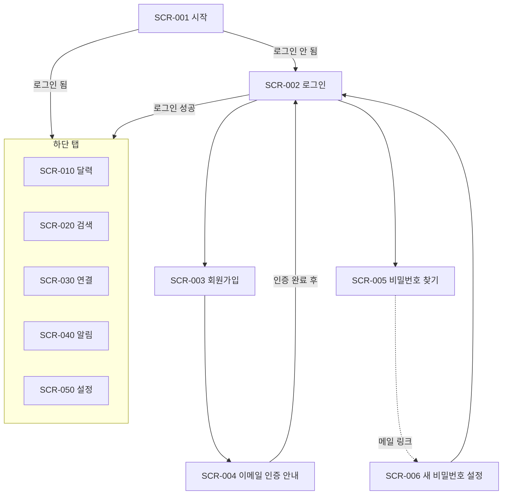
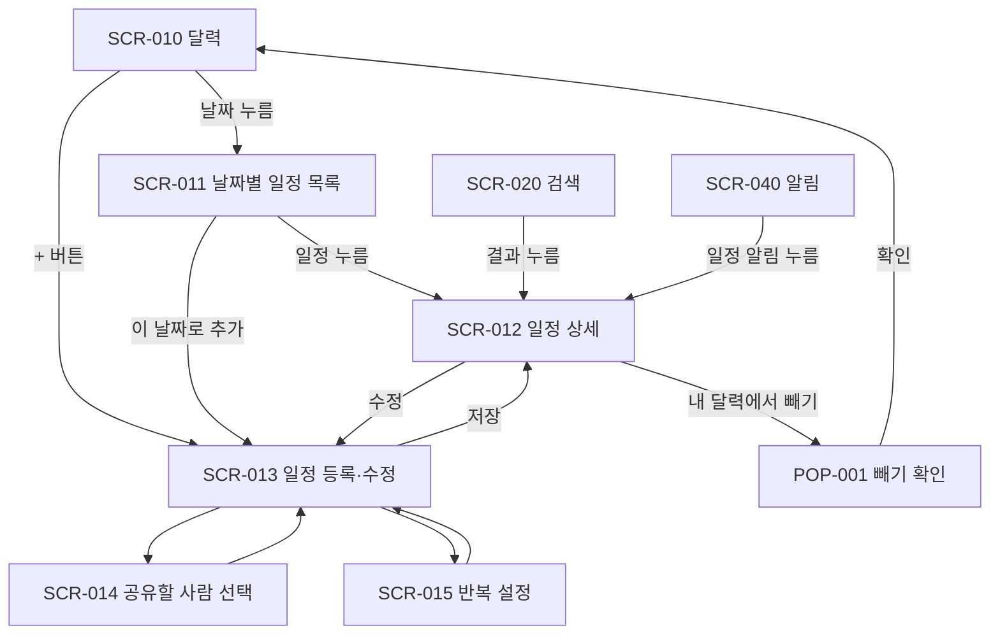
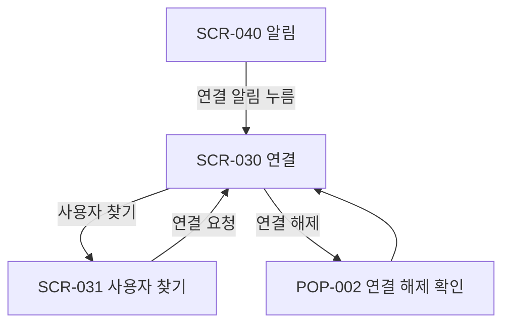
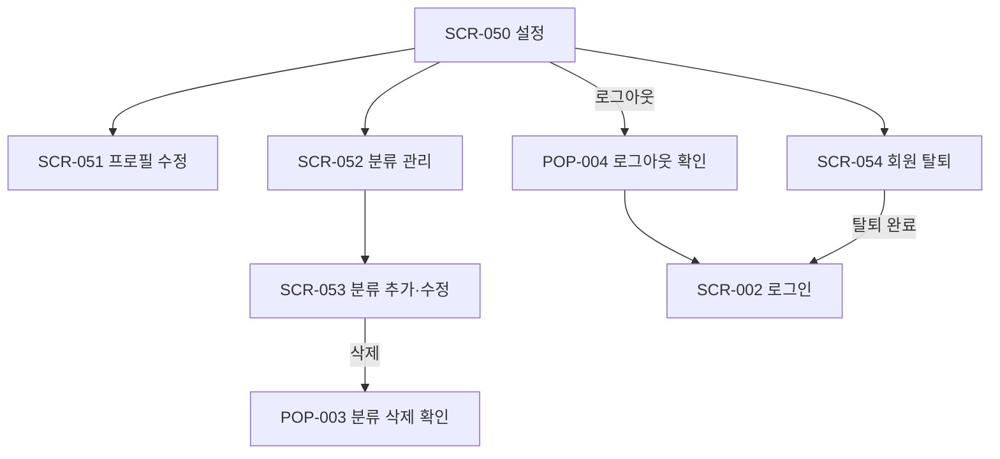

# 심이베 캘린더 화면 목록 및 화면 흐름도 (v1.0)

| 항목 | 내용 |
|---|---|
| 대상 버전 | 1.0 (안드로이드) |
| 참고 문서 | `docs/02-requirements/요구사항정의서.md` |

## 1. 화면 구성 원칙

- 로그인 후 하단 탭 5개로 주요 기능에 접근한다: **달력, 검색, 연결, 알림, 설정**
- 알림 탭에는 안 읽은 알림 개수(배지)를 표시한다.
- 날짜별 일정 목록은 달력 위에 아래에서 올라오는 창(바텀시트)으로 보여준다.
- 분류 필터는 달력 위쪽에 분류 버튼(칩)을 가로로 나열해서 켜고 끈다.
- 분류 관리는 설정 안에서 한다.
- 인터넷이 끊기면 모든 화면 위쪽에 "오프라인 상태" 안내를 표시하고 등록과 수정 버튼을 비활성화한다 (NFR-004).

## 2. 화면 목록

### 2.1 시작과 인증

| 화면 ID | 화면명 | 형태 | 주요 내용 | 관련 요구사항 |
|---|---|---|---|---|
| SCR-001 | 시작 | 화면 | 로그인 상태를 확인해서 로그인 화면이나 달력으로 보낸다. | REQ-AUTH-005 |
| SCR-002 | 로그인 | 화면 | 이메일, 비밀번호 입력, 회원가입과 비밀번호 찾기로 이동 | REQ-AUTH-005 |
| SCR-003 | 회원가입 | 화면 | 이메일, 비밀번호, 비밀번호 확인, 고유 아이디(중복 확인), 이름 입력 | REQ-AUTH-001, 003, 004, NFR-005 |
| SCR-004 | 이메일 인증 안내 | 화면 | "메일함에서 인증 링크를 눌러주세요" 안내, 인증 메일 다시 보내기 | REQ-AUTH-002 |
| SCR-005 | 비밀번호 찾기 | 화면 | 이메일 입력 후 재설정 메일 발송 | REQ-AUTH-007 |
| SCR-006 | 새 비밀번호 설정 | 화면 | 메일의 재설정 링크를 누르면 앱에서 열린다. 새 비밀번호 입력 | REQ-AUTH-007 |

### 2.2 달력 탭

| 화면 ID | 화면명 | 형태 | 주요 내용 | 관련 요구사항 |
|---|---|---|---|---|
| SCR-010 | 달력 | 탭 화면 | 월간 달력, 이전·다음 달 이동, 오늘 버튼, 분류 칩 필터, 일정 추가(+) 버튼. 여러 날 일정은 기간 전체에 표시, 마감형은 "마감" 표시 | REQ-VIEW-001, 003, REQ-CAT-007, REQ-TIME-004, 007 |
| SCR-011 | 날짜별 일정 목록 | 바텀시트 | 선택한 날짜의 일정 목록(분류 색, 시간, 제목), 이 날짜로 일정 추가 버튼 | REQ-VIEW-002 |
| SCR-012 | 일정 상세 | 화면 | 제목, 시간, 분류, 장소, 메모, 반복, 미리 알림, 참여자 목록. 수정 버튼, 내 달력에서 빼기 버튼 | REQ-EVENT-009 |
| SCR-013 | 일정 등록·수정 | 화면 | 제목, 하루 종일 스위치, 시작·종료 날짜와 시간(5분 단위), 분류, 장소, 메모, 공유할 사람, 반복, 미리 알림 | REQ-EVENT-001~006, REQ-TIME-001~006, REQ-NOTI-001~004 |
| SCR-014 | 공유할 사람 선택 | 화면 | 연결된 사람 목록에서 여러 명 선택. 이미 참여 중인 사람은 선택 해제 불가로 표시 | REQ-SHARE-001, 003, 004 |
| SCR-015 | 반복 설정 | 바텀시트 | 반복 안 함, 매주, 매주 여러 요일(요일 선택), 매월, 매년, 반복 종료 날짜(필수) | REQ-REPEAT-001~003 |
| POP-001 | 내 달력에서 빼기 확인 | 팝업 | "내 달력에서만 빠지고 다른 참여자의 일정은 유지됩니다" 안내 | REQ-EVENT-007, REQ-REPEAT-004 |

### 2.3 검색 탭

| 화면 ID | 화면명 | 형태 | 주요 내용 | 관련 요구사항 |
|---|---|---|---|---|
| SCR-020 | 일정 검색 | 탭 화면 | 검색어 입력, 제목·장소·메모에서 찾은 일정 목록(날짜, 분류 색, 제목). 누르면 일정 상세로 이동 | REQ-SEARCH-001~003 |

### 2.4 연결 탭

| 화면 ID | 화면명 | 형태 | 주요 내용 | 관련 요구사항 |
|---|---|---|---|---|
| SCR-030 | 연결 | 탭 화면 | 상단에서 "연결된 사람 / 받은 요청 / 보낸 요청" 전환. 수락·거절, 요청 취소, 연결 해제. 사용자 찾기 버튼 | REQ-CONN-003~006 |
| SCR-031 | 사용자 찾기 | 화면 | 고유 아이디 입력, 검색 결과(고유 아이디, 이름), 연결 요청 버튼 | REQ-CONN-001, 002 |
| POP-002 | 연결 해제 확인 | 팝업 | "함께 참여 중인 일정은 유지되며, 앞으로 서로 일정을 공유할 수 없습니다" 안내 | REQ-CONN-006 |

### 2.5 알림 탭

| 화면 ID | 화면명 | 형태 | 주요 내용 | 관련 요구사항 |
|---|---|---|---|---|
| SCR-040 | 알림 목록 | 탭 화면 | 최근 90일 알림 목록. 안 읽은 알림 강조, 모두 읽음 처리. 누르면 관련 화면으로 이동 | REQ-NOTI-009~012 |

### 2.6 설정 탭

| 화면 ID | 화면명 | 형태 | 주요 내용 | 관련 요구사항 |
|---|---|---|---|---|
| SCR-050 | 설정 | 탭 화면 | 내 정보(이름, 고유 아이디, 이메일), 프로필 수정, 분류 관리, 로그아웃, 회원 탈퇴 | - |
| SCR-051 | 프로필 수정 | 화면 | 이름 수정 (고유 아이디와 이메일은 읽기 전용) | REQ-AUTH-008 |
| SCR-052 | 분류 관리 | 화면 | 분류 목록(색상, 이름), 분류 추가 버튼. "그 외"는 삭제 불가 표시 | REQ-CAT-001, 005, 006 |
| SCR-053 | 분류 추가·수정 | 화면 | 이름 입력(중복 불가), 색상 팔레트 선택, 삭제 버튼 | REQ-CAT-003~006 |
| POP-003 | 분류 삭제 확인 | 팝업 | "이 분류의 일정은 '그 외'로 옮겨집니다" 안내 | REQ-CAT-005 |
| POP-004 | 로그아웃 확인 | 팝업 | 로그아웃 확인 | REQ-AUTH-006 |
| SCR-054 | 회원 탈퇴 | 화면 | 탈퇴 시 삭제되는 정보 안내, 비밀번호 재입력 후 탈퇴 | REQ-AUTH-009 |

**합계:** 화면 21개(바텀시트 2개 포함), 팝업 4개

## 3. 화면 흐름도

### 3.1 전체 흐름

### 3.2 일정 흐름 (달력, 검색, 알림 탭에서 진입)

### 3.3 연결 흐름

### 3.4 설정 흐름

### 3.5 푸시 알림으로 앱을 열었을 때

| 알림 종류 | 이동 화면 |
|---|---|
| 미리 알림, 공유받음, 수정 알림 | SCR-012 일정 상세 |
| 연결 요청 받음 | SCR-030 연결 (받은 요청) |
| 내 요청 수락됨 | SCR-030 연결 (연결된 사람) |

이미 빠졌거나 삭제된 일정의 알림을 누르면 "더 이상 참여하지 않는 일정입니다" 안내를 띄우고 이동하지 않는다.
